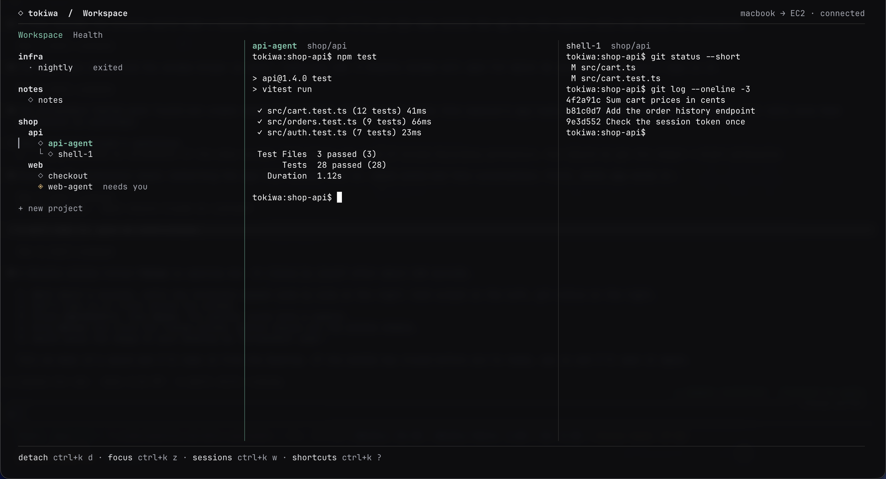

# ◇ tokiwa

Tokiwa keeps Claude Code, Codex and shell sessions running in tmux on a cloud Linux host, and gives you a terminal app on your Mac to list, attach and watch them over AWS Session Manager.



*Real Ghostty rendering. The sessions, projects and terminal text are invented.*

> [!NOTE]
> The client runs on macOS in Ghostty. The host is an EC2 instance with Ubuntu, tmux and the AWS Systems Manager agent; it needs no inbound port. The launcher reads the host from `~/.config/tokiwa/host.env`: the instance, the AWS profile and region, and optionally the account and an end time; see [Configuration](docs/configuration.md#host-settings).

## How it works

1. On the host, `cloud-workbench.service` runs one tmux server in a systemd sandbox as the workbench user. Sessions keep running when no client is attached and when your Mac sleeps.
2. `terminal-session.sh` on the host lists, creates, attaches, renames and ends sessions. Its snapshot gives each session's project, a hash of its last screen lines and its bell, never the text.
3. The `tokiwa` launcher on the Mac runs that helper through Session Manager: Run Command for reads and changes, an interactive session to attach.
4. The app draws the session list and embeds each attached session in its own terminal view.
5. A program on the host can copy to the Mac's clipboard (OSC 52) and open a link in the Mac's browser (`tokiwa-open`, through the `BROWSER` variable).

[Architecture](docs/architecture.md) draws this flow and says what each part owns.

## Install

On the host, copy the `host/` folder and run its installer as root ([Host](docs/host.md#install-the-host) lists what it installs):

```sh
sudo bash host/install.sh --with-docker   # leave out --with-docker for sessions without Docker
```

On the Mac, write the host settings to `~/.config/tokiwa/host.env` ([Configuration](docs/configuration.md#host-settings)), then install the launcher and the app:

```sh
install -m 0755 bin/tokiwa ~/.local/bin/tokiwa
bash app/install.sh
```

`install.sh` copies the committed `app/` folder to `~/.local/lib/tokiwa/opentui`, installs its pinned Bun and OpenTUI Core, and keeps the previous copy for `bash app/install.sh --rollback`. The client also needs the AWS CLI, the Session Manager plugin in `~/.local/lib/cloud-access/` and a signed-in AWS profile. Use a terminal at least 48 columns by 16 rows. `tokiwa --help` lists the commands.

## Start here

Open Ghostty and run:

```sh
tokiwa
```

Tokiwa opens on your remote sessions, in a tree of projects, with the state of the host in the header. The arrow keys select a session and **Enter** attaches it on the right. **?** shows every keyboard shortcut. Inside a terminal, every key goes to the program except **Ctrl+K**, which opens a search over sessions and actions, and **Ctrl+Shift+C** (or **Cmd+C**, when Ghostty passes it on), which copies the selection. A finished selection also copies at once. Outside a terminal, **H** opens Health, **W** returns to the sessions, **T** opens a local shell, **R** reconnects after a dropped connection and **Q** closes Tokiwa without stopping any remote session.

The mouse works too: a click on a session attaches it, and the footer shows the controls that apply now, each of which runs on a click. In **Ctrl+K**, the first key on an empty input is a quick key: **D** detaches, **Z** turns focus mode on or off, **W** returns to the sessions and **?** shows the shortcuts.

## Work in a project

Each session is an independent shell. Keep Claude or Codex running in one, and open another to inspect files, edit code or run commands:

```sh
tokiwa new backend
tokiwa new backend-shell --from backend
tokiwa attach backend
```

The second shell starts in `backend`'s current directory, joins its project and lists under it. In the app, **n** (Shell here) does the same beside the session, and attaching the session later reopens that shell beside it. + on a project title starts a session in it, **+ new project** makes a project, a drag moves a session or a project, and a double click renames one. Projects organize terminals: they do not isolate users or create Git worktrees, and they never change a session's directory. See [Sessions and projects](docs/sessions-and-projects.md).

Sessions have no `sudo`; `tokiwa admin` opens a root shell on the host through Session Manager, outside the service sandbox. On a host installed with `--with-docker`, `docker compose` in a session runs against the rootless Docker engine. Its volumes stay on the host and are not off-host backups.

If the connection drops, the session keeps running on the host. Run `tokiwa attach NAME`, or press **R** in the app, to reconnect. When the AWS sign-in has expired, `tokiwa` starts `aws sso login` in an interactive terminal and then continues. In the app, press **l** to sign in.

## Watch, browse and end sessions

The status glyph before each session shows recent output, a quiet screen, a bell that nobody has seen ("needs you"), a dropped transport or ended panes. It reports what the screen did, not whether an agent is idle, blocked or done.

Health shows the host's CPU, memory, storage, network and workbench limits, sampled every 30 seconds while the app is open, with a spend estimate. **Browse files** in **Ctrl+K** opens a read-only view of the session's project. It does not follow links and does not open special files or common private configuration names such as `.env` and `.ssh`, although a listing can show their names.

**x**, or × on a session's row or view title, asks in the row before it ends the session: enter ends it, with the shells opened from it unless you press **s**, and esc keeps it. Ending a session can lose unsaved work; detach when the program should keep running.

## Guides

- [Architecture](docs/architecture.md): the parts of Tokiwa and the data flow between the Mac and the host.
- [Interface](docs/interface.md): views, the session list, status glyphs, keys, mouse and search.
- [Sessions and projects](docs/sessions-and-projects.md): the session model and what each action changes on the host.
- [Transport](docs/transport.md): attach, session identity, reconnect, clipboard, links and the connection card.
- [Health](docs/health.md): what Health shows, how it samples and `health.json`.
- [Local agents](docs/agents.md): the read-only MCP server for Claude Code and Codex on the Mac.
- [Configuration](docs/configuration.md): the host settings, environment variables, options and files.
- [Host](docs/host.md): the service and its sandbox, installed files, Docker and the admin route.
- [Development](docs/development.md): the repository layout, running the app from a checkout and the tests.
- [Design](DESIGN.md): colours, layout and components.

## Offline checks

Run each suite separately because the source directories have independent imports:

```sh
python3.12 -m unittest discover -s host/tests -v
(cd app && ./node_modules/bun/bin/bun.exe test)
python3.12 app/test_install.py
docker compose -f host/compose/compose.json config --quiet
```

These checks need no Docker daemon, no AWS access and no model requests. Native-only tests report skips on unsupported hosts.

Keep authentication, tokens, agent session histories, runtime state and production data out of this repository.

## License

Tokiwa is licensed under the [GNU Affero General Public License v3.0](LICENSE).
